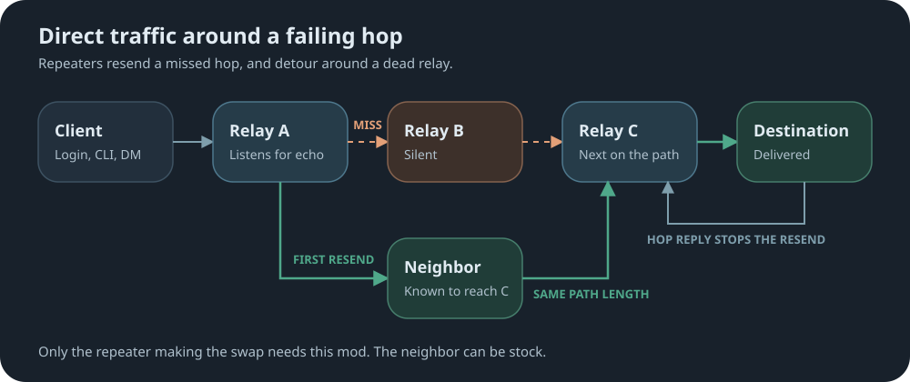

# auto-route

[↩ Back to firmware readme](../../README.md)

**MeshCore:** direct traffic follows one fixed path, so one missed hop loses the packet.

**Auto-Route:** repeaters resend a missed hop, and detour around a dead relay through a neighbour known to reach the next hop beyond.

```text
set autoroute on
get autoroute.stats
```



## What it does

- Off by default.
- **Resends:** after sending a direct packet, a repeater listens for the next hop to repeat it, and resends up to twice if it hears nothing. A last hop gets one resend, because a stock client cannot answer.
- **Detours:** when the next hop stays silent, the first resend goes to another neighbour known to reach the hop after, with the best signal among them. One per packet. The path keeps its length.
- **Hop replies:** a repeater that receives a direct packet addressed to it sends one short zero-hop reply, which stops the last relay's resend.
- **Learning:** flood packets name the repeaters they passed through, which shows a repeater who can reach whom. It detours only through a neighbour it has heard directly and seen linked to the hop after the failing one. Until then, it only resends.

## What it costs

- **Airtime:** only after a miss, plus hop replies.
- **Power:** nothing measurable at idle on a heltec_v4.
- **Memory:** about 3 KB of RAM.
- **Stock neighbours:** they relay and receive these packets normally, and a detour can go through one. A stock destination sends no hop reply, so the last relay always spends its one resend.

Hop replies use control packet type `0xA0`. Stock repeaters ignore it; a stock companion passes it to its connected app.

## CLI Commands

Detailed syntax and responses are in the [auto-route CLI reference](docs/cli-additions.md).

[↩ Back to firmware readme](../../README.md)
